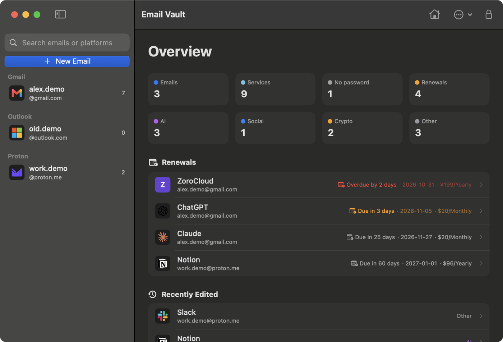
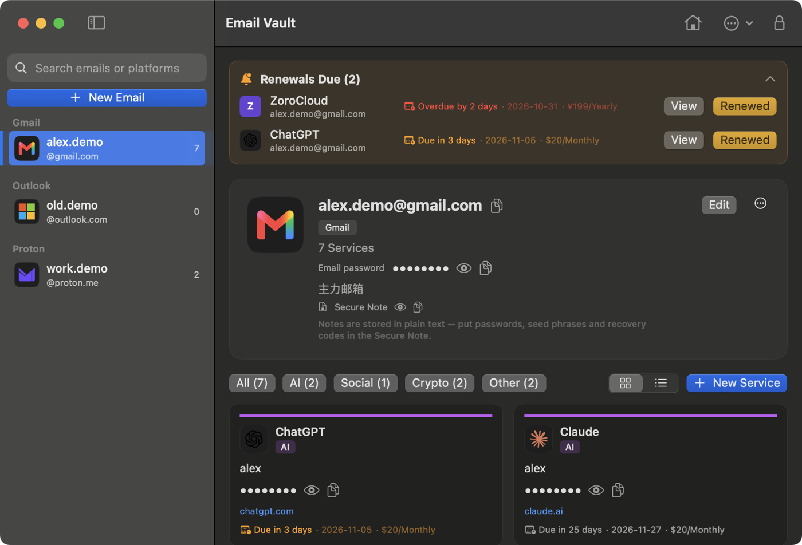

<p align="center">
  
</p>

<h1 align="center">Email Vault</h1>

<p align="center">
  A local-only, offline password vault for macOS that organizes accounts by the email you signed up with — and keeps track of subscription renewals.
</p>

<p align="center">
  <b>English</b> · <a href="README.zh-CN.md">简体中文</a>
</p>

<p align="center">
  <a href="https://github.com/mortalxu98/email-vault/actions/workflows/ci.yml"></a>
  
  
  <a href="LICENSE"></a>
</p>

<p align="center">
  
  
</p>

<p align="center"><sub>Screenshots use demo data.</sub></p>

## Features

**Accounts**
- Emails are grouped by provider (Gmail, Outlook, Proton, iCloud, QQ…); each email lists the platforms registered with it.
- 70+ built-in platforms (AI, social, crypto…) with autocomplete for name, category and URL, plus brand icons.
- Card and list views, category filters and global search; right-click to copy a username or password or open the URL.

**Security**
- Argon2id key derivation and AES-256-GCM encryption for passwords and secure notes; the key lives only in memory.
- Secure notes for seed phrases, recovery codes and 2FA secrets, encrypted like passwords.
- Optional Touch ID unlock backed by the Secure Enclave; the master password is still required every 14 days.
- Auto-lock after 10 minutes idle and on sleep, screen lock, screensaver or user switch.
- Copied secrets are marked concealed and cleared after 30 seconds or on lock.
- Change the master password with a single-transaction re-encryption that rolls back on any failure.

**Renewals**
- Track due date, cycle (one-time, monthly, yearly), amount and how many days ahead to be reminded.
- Upcoming and overdue renewals show in a banner; "Renewed" moves the date forward one cycle.

**Data**
- One SQLite file; schema changes are additive and the database is backed up before every migration.
- One-click encrypted backup, plus a plain-text CSV export (master password required) for migrating elsewhere.
- English and Simplified Chinese UI, following the system language.

## Install

Download the latest `EmailVault-<version>.dmg` from [Releases](https://github.com/mortalxu98/email-vault/releases/latest), open it and drag Email Vault into Applications. Requires macOS 14+ on Apple silicon.

The app is not notarized by Apple. On first launch macOS says it can't verify the developer: click **Done**, then go to **System Settings → Privacy & Security** and click **Open Anyway** at the bottom. You only need to do this once.

On first launch you set a master password (8+ characters). **It cannot be recovered** — if you forget it, the data cannot be decrypted.

To upgrade, drag the new version into Applications and choose Replace. Your data lives in `~/.local/share/email-vault/` and is left untouched. **Email Vault → Check for Updates…** opens the latest release page.

### Build from source

Requires macOS 14+ and a Swift 5.9+ toolchain (Command Line Tools are enough).

```bash
git clone https://github.com/mortalxu98/email-vault.git
cd email-vault/email-swift
./scripts/package-dmg.sh      # writes dist/EmailVault-<version>.dmg
```

Run `./scripts/build.sh` if you only need the `.app`.

## Usage

| Action | How |
|---|---|
| New email / new service | ⇧⌘N / ⌘N (select an email first) |
| Search | ⌘F |
| Lock now | ⌘L, or the lock button in the toolbar |
| Back to overview | House button in the toolbar |
| Copy, open URL, edit, delete | Right-click a service card |
| Backup, CSV export, change password, Touch ID | Toolbar **…** menu |

## Security model

| Data | Stored as |
|---|---|
| Email and service passwords | AES-256-GCM ciphertext |
| Secure notes | AES-256-GCM ciphertext |
| Email addresses, platform names, usernames, URLs, notes, renewal info | Plain text (for search and reminders) |

- **Key derivation**: Argon2id v1.3, `t=3, m=64 MiB, p=4`, random 16-byte salt; parameters are stored in the database.
- **Password check**: the derived key must decrypt a fixed verifier; no password hash is stored.
- **Touch ID**: the vault key is sealed with ECDH + HKDF + AES-GCM to a Secure Enclave key bound to the current fingerprints. The sealed file only opens on this Mac and is invalidated when fingerprints change.
- **Out of scope**: malware running while the vault is unlocked, anyone who passes your fingerprint check, a leaked master password. Don't put secrets in plain-text fields.

The app never touches the network, writes no logs and never stores plaintext on disk or in caches (except a CSV you explicitly export). The full on-disk format is specified in [docs/data-format.md](docs/data-format.md).

## Data and backups

| Path | Contents |
|---|---|
| `~/.local/share/email-vault/vault.db` | Database (0600) |
| `~/.local/share/email-vault/backups/` | Automatic backups before migrations and password changes |
| `~/.local/share/email-vault/vault.touchid.json` | Touch ID seal (only when enabled) |

- **Back up**: toolbar **…** → Export Backup, or `sqlite3 ~/.local/share/email-vault/vault.db ".backup <dest>"`.
- **Restore**: quit the app, replace `vault.db` with the backup and reopen; unlock with the master password from when the backup was made.
- **Use another database**: `open -n --env EMAIL_VAULT_DB=/path/to/vault.db "/Applications/Email Vault.app"`.

## Development

```
email-swift/
├── Sources/EmailVaultCore/   Crypto, auth, SQLite store and migrations, platform catalog, CSV export
├── Sources/EmailVaultApp/    SwiftUI views and app state
├── Sources/CArgon2/          Argon2 reference implementation
├── Tests/                    Core unit tests
├── Localization/             UI translations (en / zh-Hans)
└── scripts/                  Build, DMG packaging, release, icon, translation check
```

```bash
cd email-swift
swift build
swift test        # needs full Xcode
```

See [CONTRIBUTING.md](CONTRIBUTING.md) for the workflow, conventions and release steps, [email-swift/docs/design.md](email-swift/docs/design.md) for architecture notes and [CHANGELOG.md](CHANGELOG.md) for release history.

## Security

Please report vulnerabilities privately as described in [SECURITY.md](SECURITY.md) — not in public issues.

## License

[MIT](LICENSE)

## Acknowledgements

- The [Argon2](https://github.com/P-H-C/phc-winner-argon2) reference implementation, [GRDB.swift](https://github.com/groue/GRDB.swift) and [swift-crypto](https://github.com/apple/swift-crypto)
- Brand icons come from the CC0 sets [gilbarbara/logos](https://github.com/gilbarbara/logos) and [Simple Icons](https://simpleicons.org); trademarks belong to their owners.
