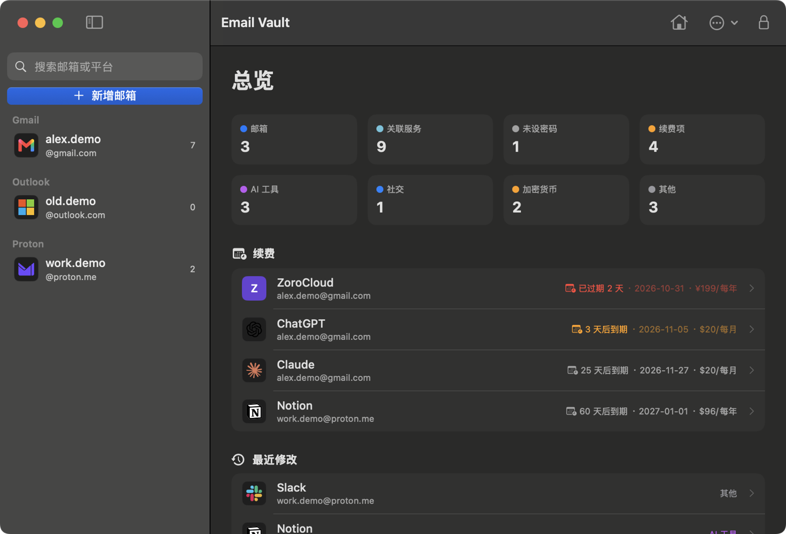
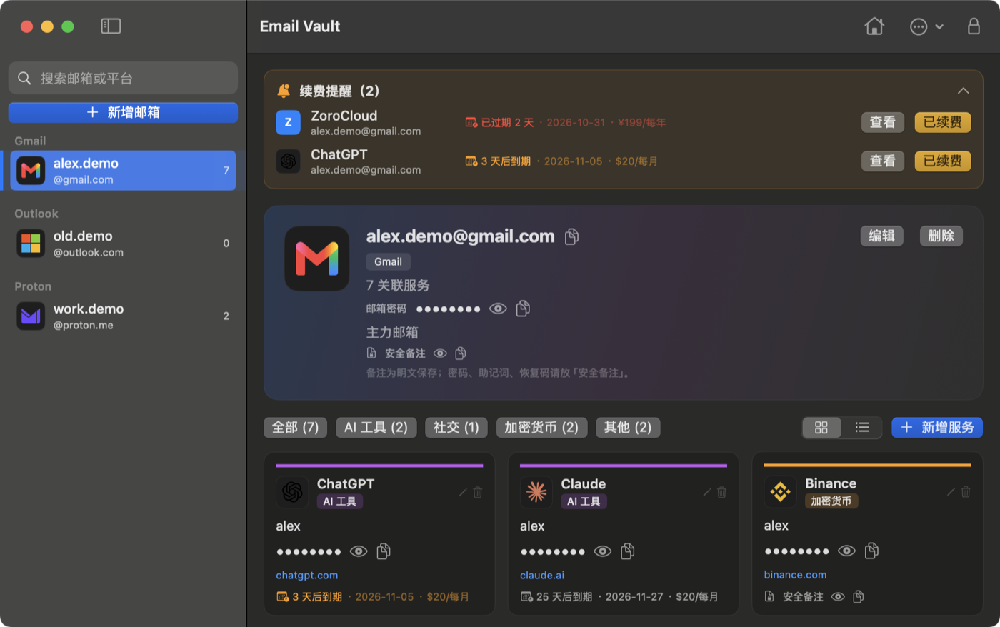
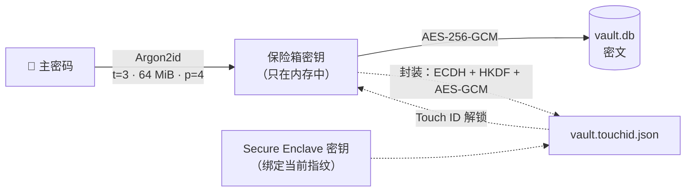

<p align="center">
  
</p>

<h1 align="center">Email Vault</h1>

<p align="center">
  <b>纯本地、离线运行的 macOS 密码库</b><br>
  按「邮箱 → 注册过的平台」组织账号，并跟踪订阅续费。
</p>

<p align="center">
  <a href="README.md">English</a> · <b>简体中文</b>
</p>

<p align="center">
  <a href="https://github.com/opsfantasy/email-vault/releases/latest"></a>
  <a href="https://github.com/opsfantasy/email-vault/actions/workflows/ci.yml"></a>
  
  <a href="LICENSE"></a>
</p>

<p align="center">
  <a href="https://github.com/opsfantasy/email-vault/releases/latest"></a>
  &nbsp;
  <a href="#安装"></a>
</p>

<p align="center">
  
  
</p>

<p align="center"><sub>截图使用演示数据。</sub></p>

<p align="center">
  <sub>技术栈</sub><br>
  
  
  
  
  
  
</p>

## 特性

<table>
<tr>
<td width="50%" valign="top">

### 📬 账号管理

- 邮箱按服务商（Gmail、Outlook、Proton、iCloud、QQ……）分组，每个邮箱下记录它注册过的平台
- 内置 70+ 常用平台（AI、社交、加密货币等），自动补全并显示品牌图标
- 卡片 / 列表视图、分类筛选、全局搜索
- 右键快速复制用户名、密码或打开网址

### 🔔 续费提醒

- 到期日、周期（一次性 / 每月 / 每年）、金额、提前提醒天数
- 即将到期或已过期的项目在顶部提示
- 「已续费」自动顺延一个周期

</td>
<td width="50%" valign="top">

### 🔐 安全

- Argon2id + AES-256-GCM 加密密码与安全备注，密钥只在内存中
- 安全备注：加密保存助记词、恢复码、2FA 密钥
- Touch ID 解锁（Secure Enclave），每 14 天仍需输入一次主密码
- 闲置、睡眠、锁屏、屏保、切换用户时自动锁定
- 复制的密码标记为 concealed，30 秒后自动清除

### 💾 数据

- 单个 SQLite 文件；只加列的迁移，迁移前自动备份
- 一键导出加密备份或 CSV
- 界面支持简体中文和英文
- 不联网、无遥测、不写日志

</td>
</tr>
</table>

## 安装

使用 [Homebrew](https://brew.sh)：

```bash
brew tap opsfantasy/tap
brew trust opsfantasy/tap      # Homebrew 7 起需要先信任第三方 tap
brew install --cask email-vault
```

或者从 [Releases](https://github.com/opsfantasy/email-vault/releases/latest) 下载最新的 `EmailVault-<版本>.dmg`，双击后把 Email Vault 拖到「应用程序」。要求 macOS 14+，Apple 芯片。

本应用未经 Apple 公证。首次打开时系统会提示无法验证开发者：点「完成」，再到 **系统设置 → 隐私与安全性** 底部点「仍要打开」，只需一次。

首次启动需设置主密码（至少 8 个字符）。**主密码无法找回**，遗忘即无法解密数据。

升级：`brew upgrade --cask email-vault`，或下载新版 DMG 拖入「应用程序」并选择替换。数据保存在 `~/.local/share/email-vault/`，不受影响。也可以在菜单「Email Vault → 检查更新…」打开最新版本页面。

### 从源码构建

需要 macOS 14+ 和 Swift 5.9+ 工具链（Command Line Tools 即可）。

```bash
git clone https://github.com/opsfantasy/email-vault.git
cd email-vault/email-swift
./scripts/package-dmg.sh      # 输出 dist/EmailVault-<版本>.dmg
```

只需要 `.app` 时运行 `./scripts/build.sh`。

## 使用

| 操作 | 方式 |
|---|---|
| 新增邮箱 / 新增服务 | ⇧⌘N / ⌘N（需先选中邮箱） |
| 搜索 | ⌘F |
| 立即锁定 | ⌘L，或工具栏锁形按钮 |
| 回到总览 | 工具栏房子按钮 |
| 复制、打开网址、编辑、删除 | 在服务卡片上右键 |
| 导出备份 / 导出 CSV / 修改主密码 / Touch ID | 工具栏「…」菜单 |

## 安全模型



| 数据 | 存储方式 |
|---|---|
| 邮箱密码、服务密码 | AES-256-GCM 密文 |
| 安全备注 | AES-256-GCM 密文 |
| 邮箱地址、平台名、用户名、网址、普通备注、续费信息 | 明文（用于搜索和提醒） |

- **密钥派生**：Argon2id v1.3，`t=3, m=64 MiB, p=4`，16 字节随机 salt，参数存于数据库。
- **主密码校验**：用派生密钥解密固定校验串，不存储任何密码哈希。
- **Touch ID**：保险箱密钥经 ECDH + HKDF + AES-GCM 封装到绑定当前指纹的 Secure Enclave 密钥，封装文件只能在本机解开，增删指纹后自动失效。
- **不防护的场景**：已解锁状态下的本机恶意软件、能通过你指纹验证的人、主密码泄露。明文字段不要写敏感信息。

应用不联网，不记录日志，不把明文写入磁盘或任何缓存（主动导出的 CSV 除外）。完整格式见 [docs/data-format.md](docs/data-format.md)。

## 数据与备份

| 路径 | 内容 |
|---|---|
| `~/.local/share/email-vault/vault.db` | 数据库（0600） |
| `~/.local/share/email-vault/backups/` | 迁移、修改主密码前的自动备份 |
| `~/.local/share/email-vault/vault.touchid.json` | Touch ID 封装（仅开启时存在） |

- **备份**：工具栏「…」→ 导出备份，或 `sqlite3 ~/.local/share/email-vault/vault.db ".backup <目标路径>"`。
- **恢复**：退出应用，用备份文件替换 `vault.db` 后重新打开，使用备份当时的主密码解锁。
- **指定数据库**：`open -n --env EMAIL_VAULT_DB=/path/to/vault.db "/Applications/Email Vault.app"`。

## 开发

```
email-swift/
├── Sources/EmailVaultCore/   加密、认证、SQLite 存储与迁移、平台目录、CSV 导出
├── Sources/EmailVaultApp/    SwiftUI 界面与应用状态
├── Sources/CArgon2/          Argon2 官方 C 参考实现
├── Tests/                    Core 单元测试
├── Localization/             界面翻译（en / zh-Hans）
└── scripts/                  构建、打包 DMG、发布、图标、翻译检查
```

```bash
cd email-swift
swift build
swift test        # 需要完整 Xcode
```

贡献流程、代码规范和发布步骤见 [CONTRIBUTING.md](CONTRIBUTING.md)，架构说明见 [email-swift/docs/design.md](email-swift/docs/design.md)。版本变化见 [CHANGELOG.md](CHANGELOG.md)。

## 安全

发现漏洞请按 [SECURITY.md](SECURITY.md) 私下报告，不要开公开 Issue。

## 许可证

[MIT](LICENSE)

## 致谢

- [Argon2](https://github.com/P-H-C/phc-winner-argon2) 参考实现，[GRDB.swift](https://github.com/groue/GRDB.swift)，[swift-crypto](https://github.com/apple/swift-crypto)
- 品牌图标来自 CC0 图标集 [gilbarbara/logos](https://github.com/gilbarbara/logos) 与 [Simple Icons](https://simpleicons.org)，商标归各自所有者。
